## Games

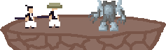

*Games I’ve made, most of them with the [Godot engine](https://godotengine.org/) for game jams as part of a team. These are all hosted on my [itch.io page](https://20akshay00.itch.io/), and most can be played right in the browser.*

Not Dead YetRepressedCyberloopV1RUS.exeSketchometryLest Ye FalterCellular ConquestSummon SquadTrickshotRadar DefenderGTA: Stress City

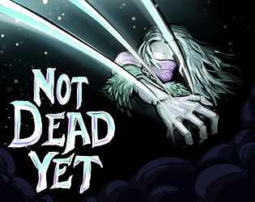 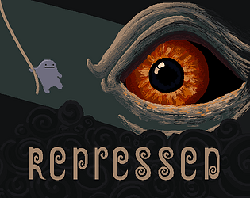 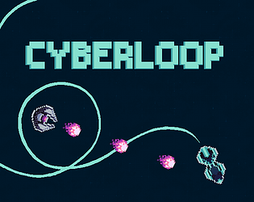 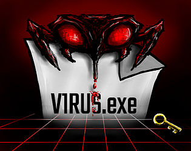 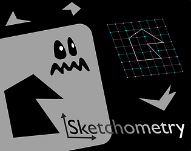 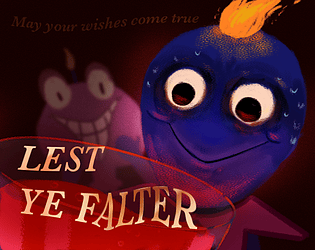 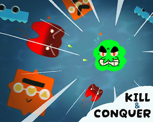 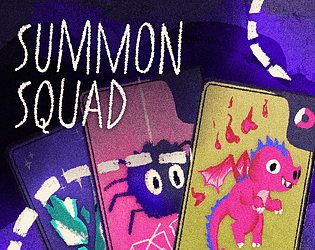 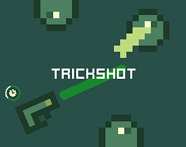 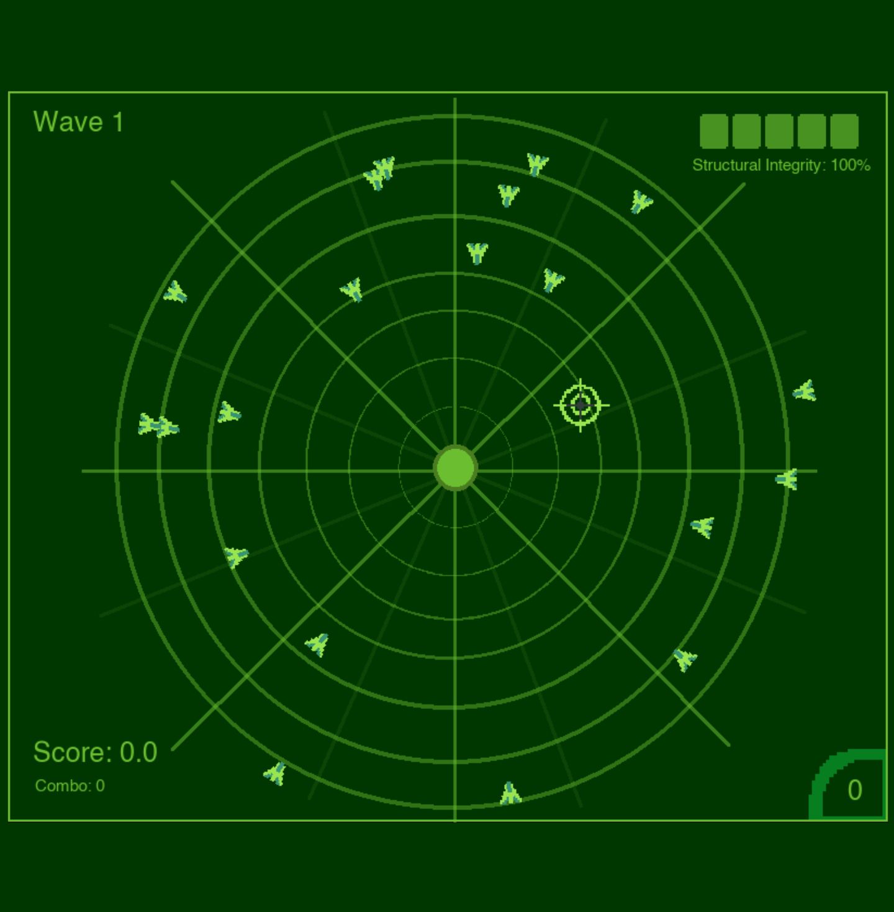 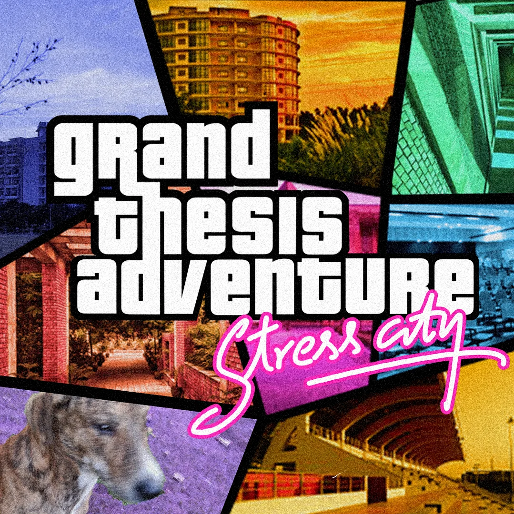

  

01 / 11

Not Dead Yet

GMTK Game Jam 2026

Your heart is stopping. The countdown has begun. Cling to life and fight to survive.

[Play](https://20akshay00.itch.io/notdeadyet)

Repressed

Brackeys Game Jam 2026.1

A memory repressed. A memory freed.

[Play](https://20akshay00.itch.io/repressed)

Cyberloop

GMTK Game Jam 2025

Your trail's a weapon and every tight turn could be your last. Outsmart, outlive and outloop.

[Play](https://20akshay00.itch.io/cyberloop)

V1RUS.exe

Beginner's Jam Winter 2024

Infect the system. Avoid detection. Deliver the payload.

[Play](https://20akshay00.itch.io/v1rusexe)

Sketchometry

GMTK Game Jam 2024

Bend, twist, and stretch your way to geometric perfection!

[Play](https://20akshay00.itch.io/sketchometry)

Lest Ye Falter

The Secret Cult Horror Jam

You sense defiance brewing among your followers. Their faith must be restored... NO MATTER THE COST.

[Play](https://quantum-forge-games.itch.io/lest-ye-falter)

Cellular Conquest

Godot Jam 2024

A cell in a petri dish, trying to grow and escape the lab.

[Download](https://quantum-forge-games.itch.io/cellular-conquest)

Summon Squad

Ludum Dare 55

Explore the crumbling ruins of forgotten treasures by solving puzzles with a little help from your summoned friends.

[Play](https://roman-hyacinths.itch.io/summon-squad)

Trickshot

GMTK Game Jam 2023

In this world, you are not the wielder but the weapon itself! Are you worthy of making the trickiest shots of them all?

[Play](https://20akshay00.itch.io/trickshot)

Radar Defender

Julia · 2022

A retro arcade-style game made using AlphaZero.jl where players must defend their base from incoming threats.

[Source](https://github.com/20akshay00/RadarDefender)

GTA: Stress City

IISER Mohali · 2021

A treasure hunt event built using the Tetra game engine.

[Play in browser](https://iiserm.github.io/GTA-Stress-City/)

          

## Origami

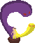

*Modular origami (golden venture folding), where many small folded paper units are slotted together to form three-dimensional shapes.*

[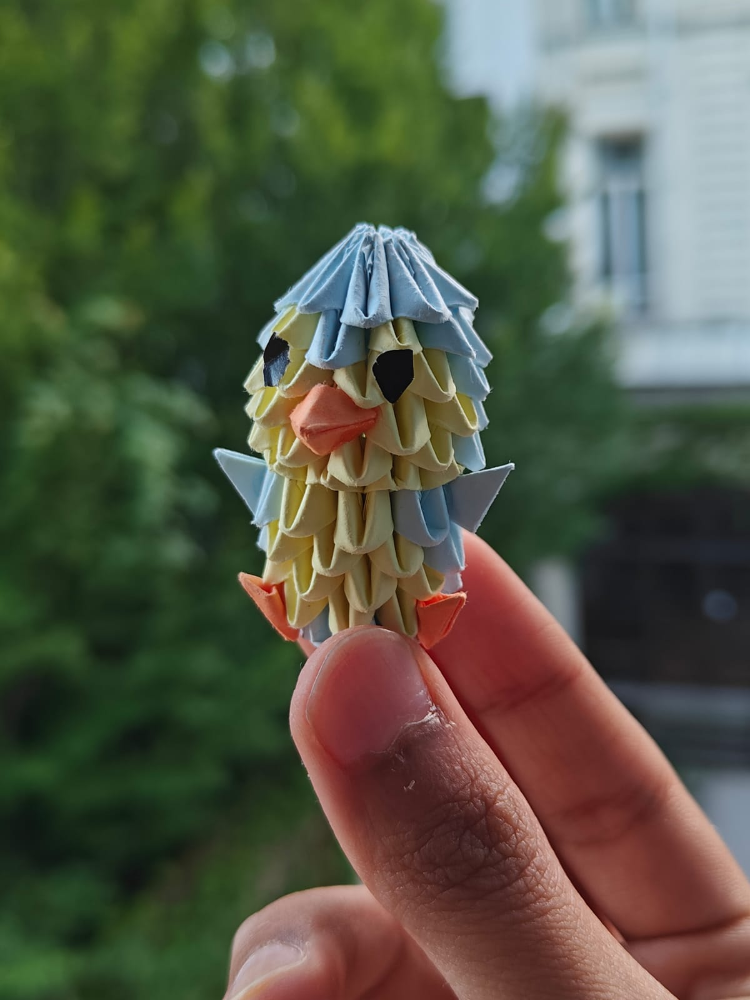](./images/origami/PenguinOrigami.jpg "Penguin")

**Penguin**

[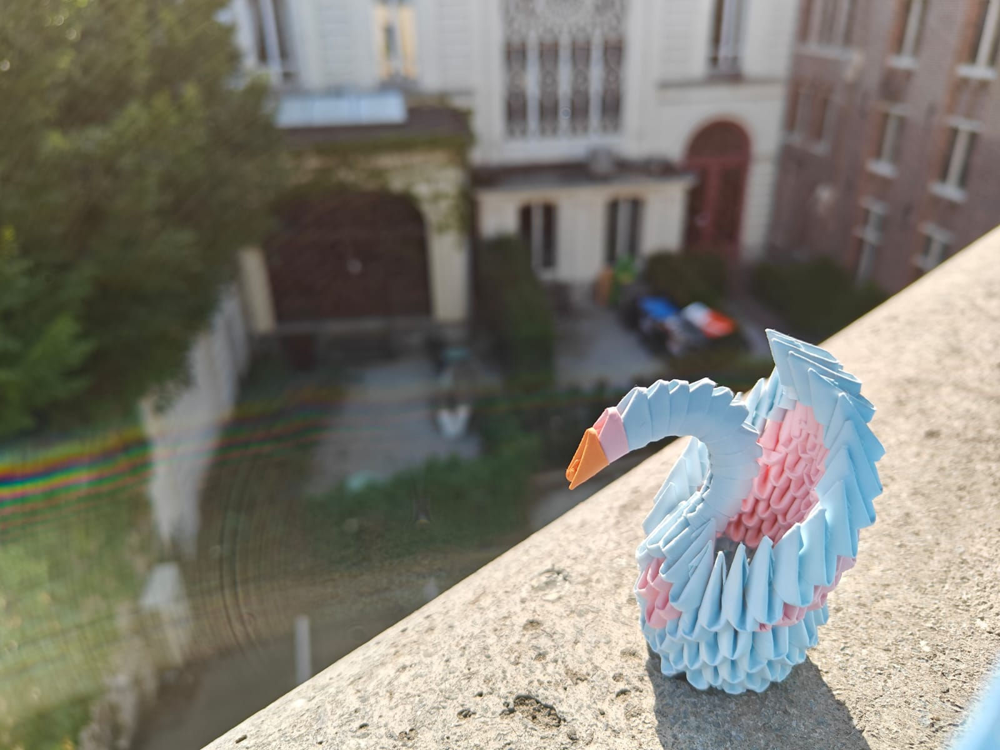](./images/origami/SwanOrigami.jpg "Swan")

**Swan**

## Pixel Art

*To make these, I use [Aseprite](https://www.aseprite.org/) which used to be FOSS till 2016, but is currently a paid (but source-available) software. It can be built locally from the source, by following [these](https://www.reddit.com/r/PixelArt/comments/on9pw6/guide_how_to_build_aseprite_from_source_aseprite/) instructions, but it is certainly worth purchasing as well.*

phi1.aseprite

FileEditSpriteLayerFrameSelectView

▣✎◌▧⬚✥◐⌖

[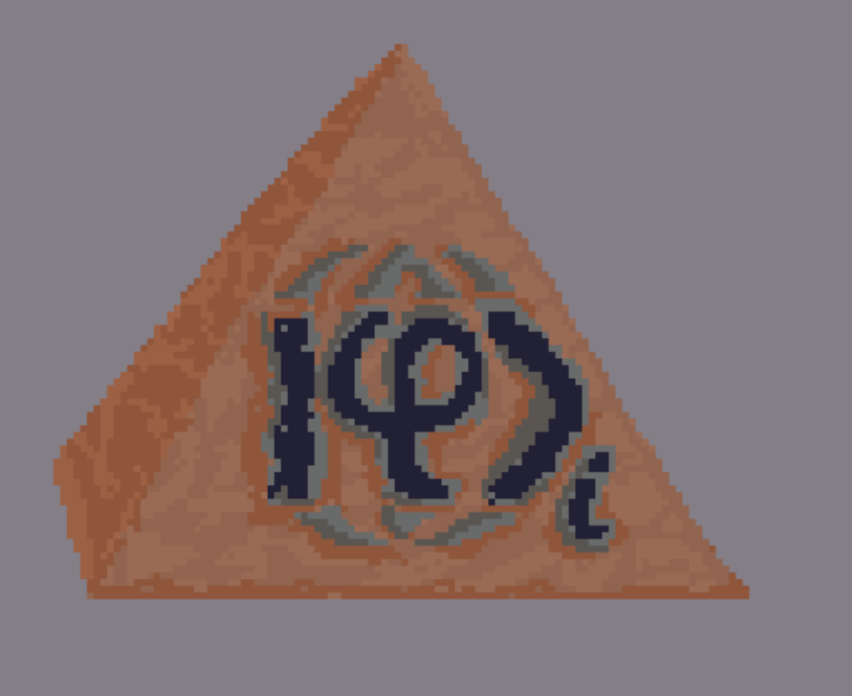](images/pixelart/phi1.png "Phi@I logo #1") [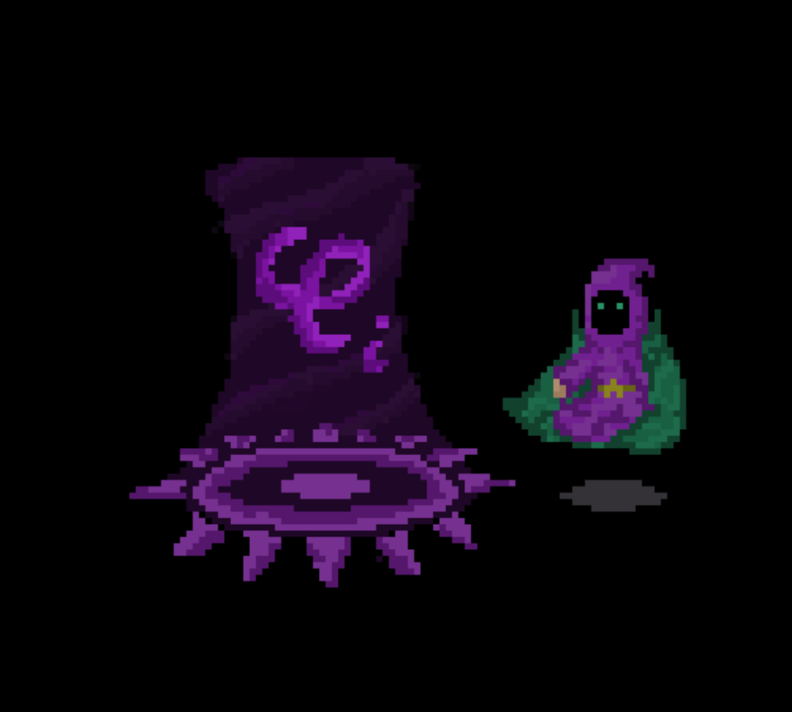](images/pixelart/phi2.png "Phi@I logo #2") [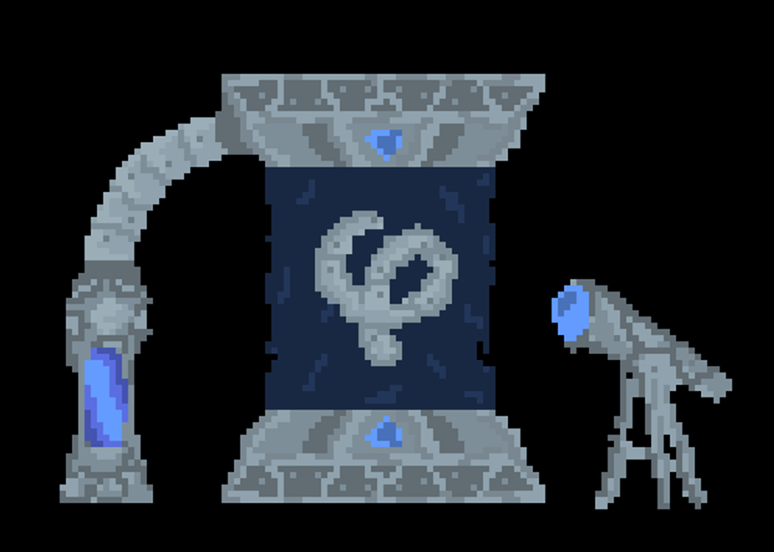](images/pixelart/phi3.png "Phi@I logo #3") [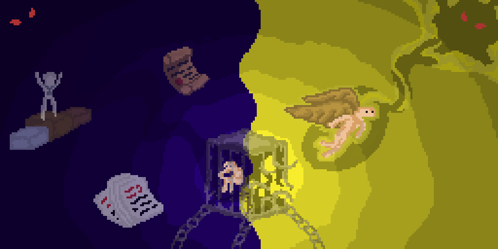](images/pixelart/choices.png "Choices") [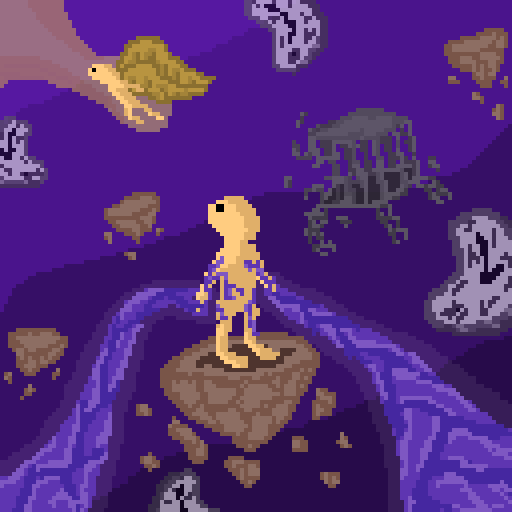](images/pixelart/trapped.png "Trapped") [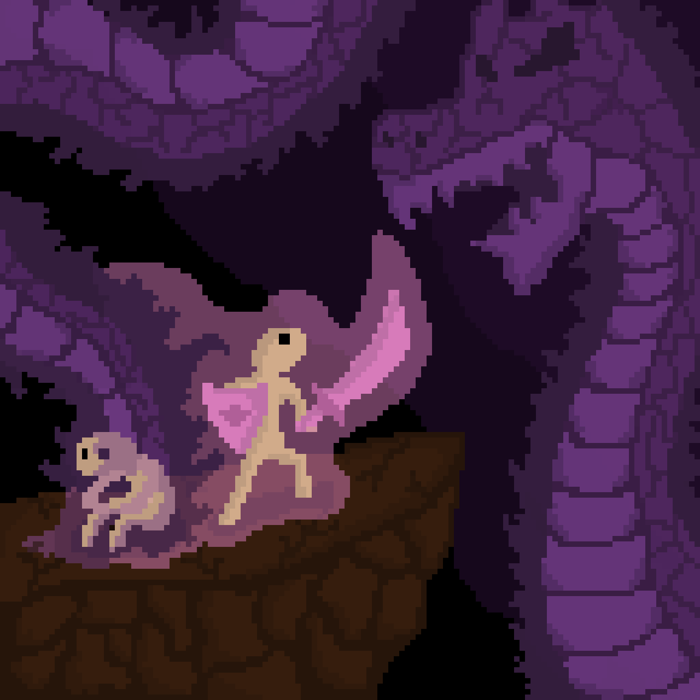](images/pixelart/entwined.png "Entwined") [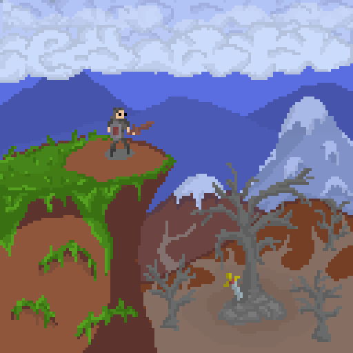](images/pixelart/adventure.png "Adventure")

Palette

Properties

Phi@I logo \#1

And God said, let there be Phi.

Phi@I logo \#2

Any sufficiently advanced technology is indistinguishable from magic.

Phi@I logo \#3

The future is now, old man.

Choices

The bad and the ugly of a competitive environment.

Trapped

A different perspective of the previous piece, Choices.

Entwined

The struggles within. Inseparable. Ensnared. Entwined.

Adventure

Inspired by Terraria. Exploring the unknown is strangely addictive.

1

2

3

4

5

6

7

◀

▶

▶

## 3D Models

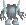

*Exploring the third dimension with [Blender](https://www.blender.org/).*

FileEditRenderWindowHelp LayoutModelingShadingRendering

▣ Render ResultSlot 1Bow and Arrow

[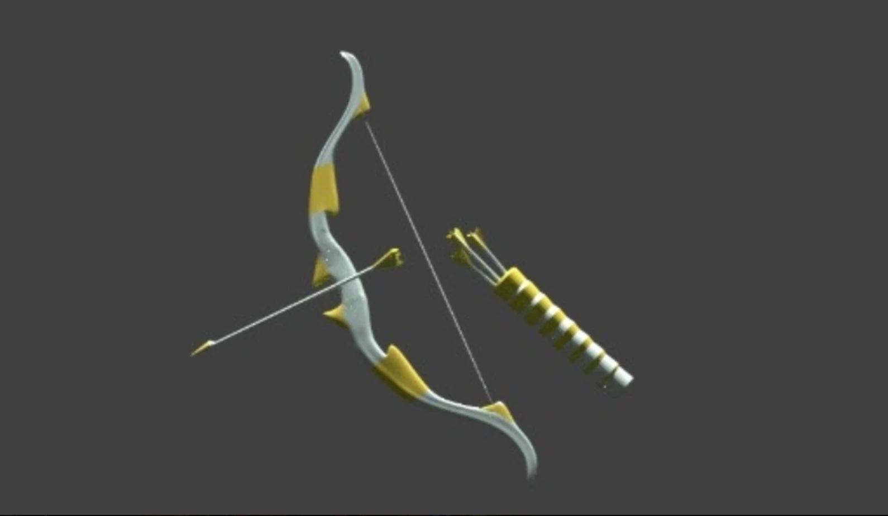](images/blender/arrow.webp "Bow and Arrow") [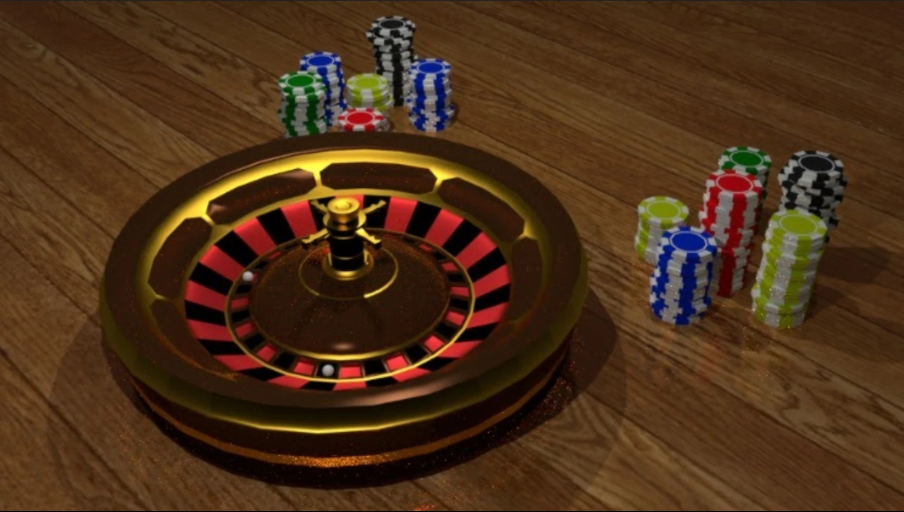](images/blender/roulette.webp "Roulette") [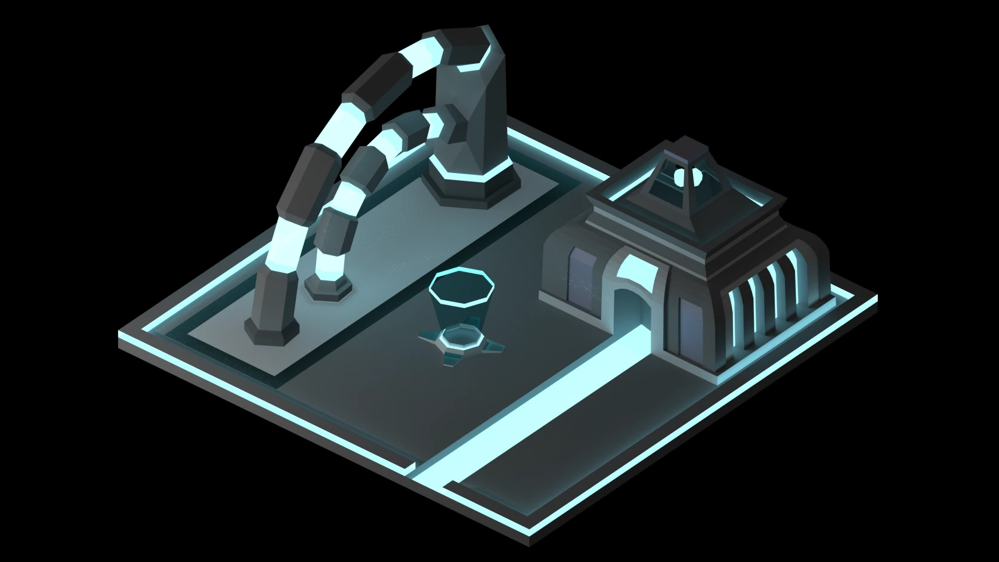](images/blender/cyberpunk.webp "Futuristic") [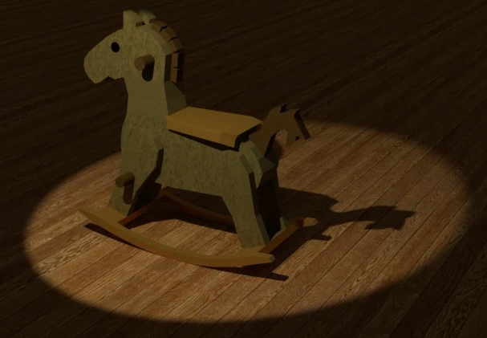](images/blender/horse.webp "Rocking Horse") [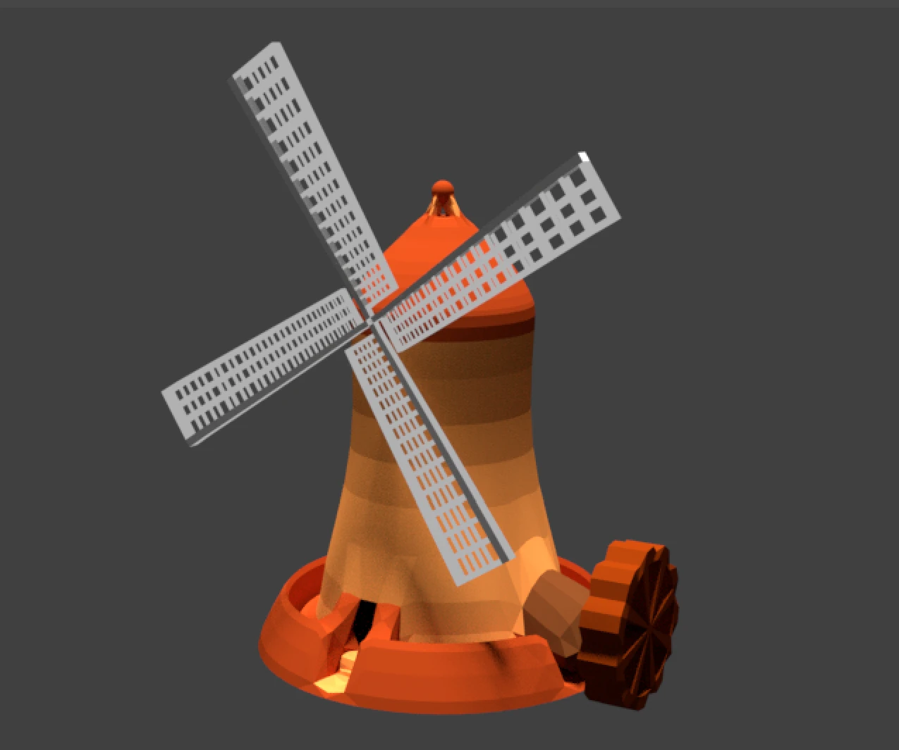](images/blender/windmill.webp "Windmill") [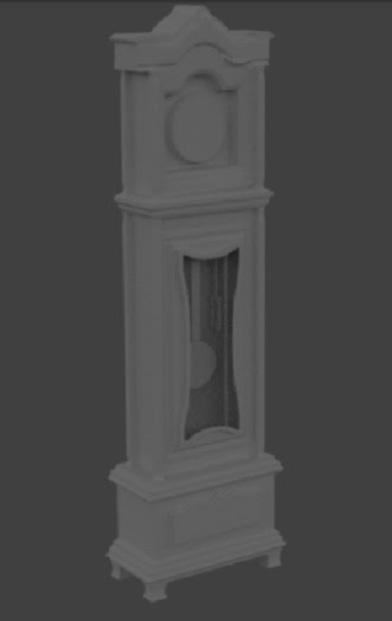](images/blender/clock.png "Grandfather Clock")

Outliner

Scene Collection

Bow and Arrow

Roulette

Futuristic

Rocking Horse

Windmill

Grandfather Clock

Object

Name**Bow and Arrow**

Name**Roulette**

Name**Futuristic**

Name**Rocking Horse**

Name**Windmill**

Name**Grandfather Clock**

◀

▶

Render Result1 / 6
