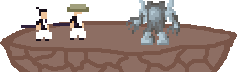
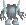

::: {.project-section}
## Games

```{=html}

```

*Games I've made, most of them with the [Godot engine](https://godotengine.org/) for game jams with friends. Those live on my [itch.io page](https://20akshay00.itch.io/), and most can be played right in the browser.*

:::{#games-arcade}
:::
:::

::: {.project-section}
## Origami

```{=html}

```

*Modular (3D) origami, where many small folded paper units are slotted together into the final shape.*

::: {.art-column-grid}

::: {.art-card}
{group="origami"}
:::

::: {.art-card}
{group="origami"}
:::

:::
:::

::: {.project-section}
## Pixel Art

```{=html}

```

*To make these, I use [Aseprite](https://www.aseprite.org/) which used to be FOSS till 2016, but is currently a paid (but source-available) software. It can be built locally from the source, by following [these](https://www.reddit.com/r/PixelArt/comments/on9pw6/guide_how_to_build_aseprite_from_source_aseprite/) instructions, but it is certainly worth purchasing as well.*

:::{#pixel-editor}
:::
:::

::: {.project-section}
## 3D Models

```{=html}

```

*Exploring the third dimension with [Blender](https://www.blender.org/).*

:::{#models-blender}
:::
:::

<script src="gallery_widgets.js"></script>
