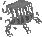

<canvas id="atom-canvas"></canvas>

Hi! I'm Akshay, a PhD student at [QuantumGroup@UGent](https://quantumghent.github.io/) with an interest in quantum gases and computational physics. These days I mostly develop *Tensor Network* algorithms to numerically study *ultracold bosonic systems in the continuum*. When I'm not performing research, I enjoy [making games](https://20akshay00.itch.io/) with the [Godot engine](https://godotengine.org/).

<script src="./atom_simulation.js"></script>

```{=html}
<!-- the stickers sit at a distance from the centre that grows with the window
     (max(px, vw)): on a normal screen the px values hold, on a big monitor they spread out.
     The cage sits inside the text column's width, so it is pinned by its bottom edge
     (top + translateY(-100%)): as it grows on wide screens it grows upwards, never onto the text -->
<div id="landing-art" hidden>
    
    
    
    <div class="sticker-trail float" style="top: 520px; left: calc(50% + max(430px, 29vw)); animation-delay: 0.7s;">
        <svg viewBox="0 0 170 120" aria-hidden="true"><path d="M30 34 C 70 6, 96 70, 70 84 S 40 70, 70 52 S 130 96, 166 112"/></svg>
        
    </div>
</div>
<script>
// the about template has no slot for these: float the sprites around the photo
(function () {
    const box = document.getElementById("landing-art"), about = document.querySelector(".quarto-about-jolla");
    if (!box || !about) return;
    about.style.position = "relative";
    [...box.children].forEach((el) => about.appendChild(el));
    box.remove();
})();
</script>
<script src="robot_walker.js"></script>
```
