## Research Software

*Specialized libraries and scripts developed during my research involving computational quantum many-body physics.*

julia — ~/research

(@v1.11) pkg\> add TentMPS

\# Numerical implementation of the Finite-Element Matrix Product State (FE-MPS) framework for simulating 1D continuum models of interacting bosons.

\# since 2026

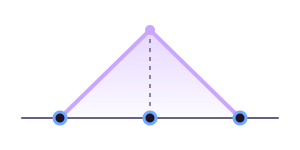

(@v1.11) pkg\> add LiebLinigerBetheAnsatz

\# Numerical implementation of the Bethe Ansatz solution for the 1D Lieb-Liniger model.

\# since 2026

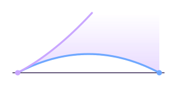

(@v1.11) pkg\> add HermiteUtils

\# Simple utilities for working with Hermite polynomials and functions.

\# since 2026

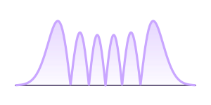

(@v1.11) pkg\>

## General Software

*Random projects made to solve a problem or explore something new.*

~/projects

Explorer

ThePhysicsHub Schedule Selector Tetra Engine Pentra Engine GDWiiInput

README.md — ThePhysicsHub

### \# ThePhysicsHub

Open source repository of interactive physics simulations created by the cumulative effort of a group of undergraduates, built with p5.js.

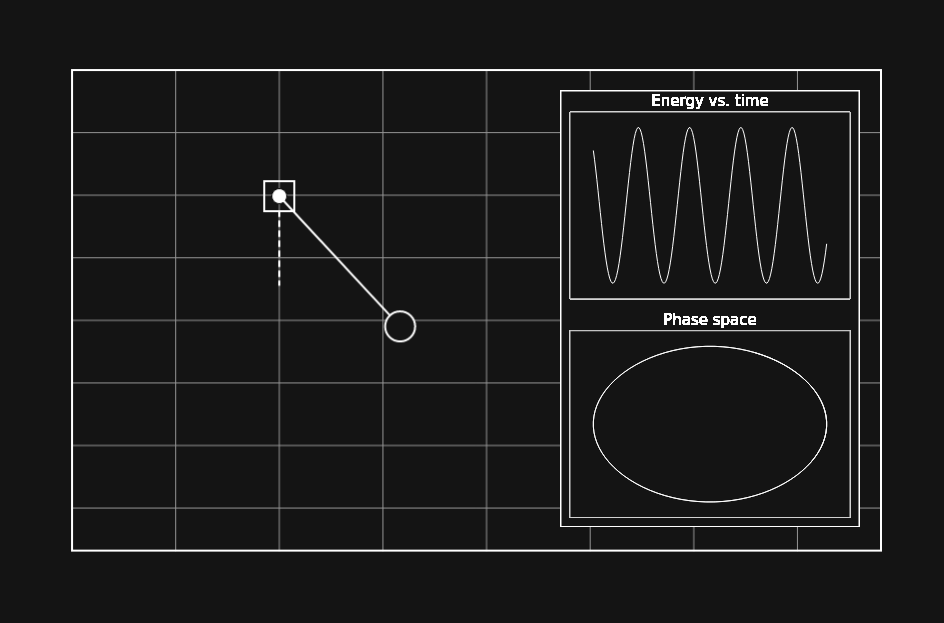 [Open project ↗](https://github.com/OpenPsiMu/ThePhysicsHub)

JavaScript2020

README.md — Schedule Selector

### \# Schedule Selector

A tool to automate course selection and schedule filtering for IISER Mohali students.

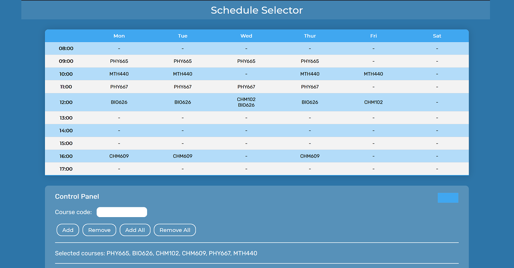 [Open project ↗](https://20akshay00.github.io/schedule-selector/)

JavaScript · HTML2021

README.md — Tetra Engine

### \# Tetra Engine

A simple 2D game engine written in Python with an Ascii-based renderer for treasure hunt events at IISER Mohali.

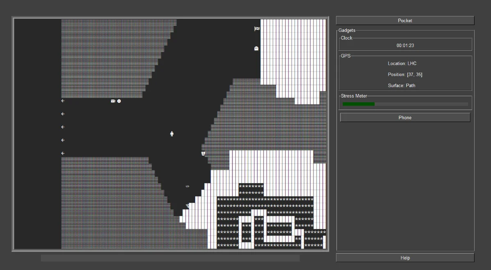 [Open project ↗](https://github.com/DhruvaSambrani/turing-hunt-engine)

Python2021

README.md — Pentra Engine

### \# Pentra Engine

An evolution of the Tetra engine utilizing Pygame for 2D rendering with lighting and shadows.

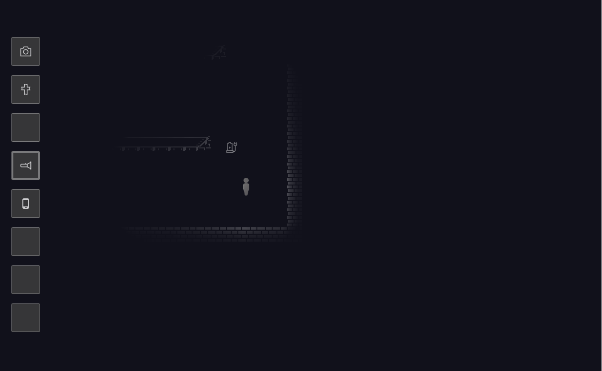 [Open project ↗](https://github.com/DhruvaSambrani/pentra)

Python2023

README.md — GDWiiInput

### \# GDWiiInput

GDExtension to use Wii controllers with the Godot game engine.

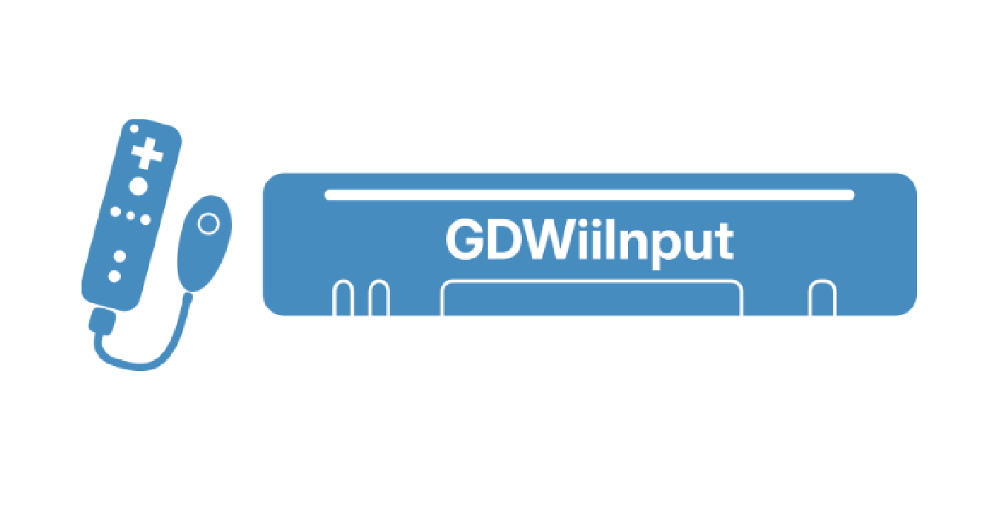 [Open project ↗](https://github.com/20akshay00/godot-wii-input/)

GDScript · C++2025

## Undergraduate Coursework

*Selected academic projects from my time at IISER Mohali.*

1.  [1. Modelling Complex Systems 2021 Numerical simulations of SIRS models, Sandpile models, and Kuramoto oscillators. Python · Julia 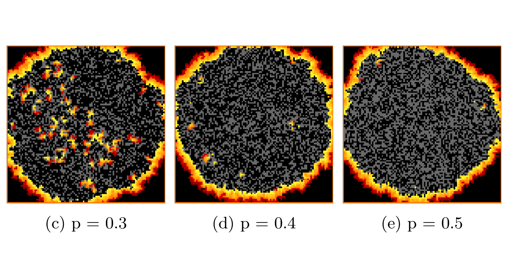](https://github.com/20akshay00/modellingComplexSystems)
2.  [2. Charge Density Estimation 2021 Exploring the piezo-electric effect in PZT and PVDF materials using COMSOL. COMSOL 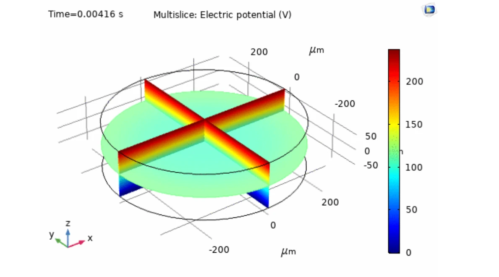](https://github.com/20akshay00/PHY312-Project)
3.  [3. News Recommender System 2022 An NLP-based recommender system using web scraping and collaborative filtering. Python 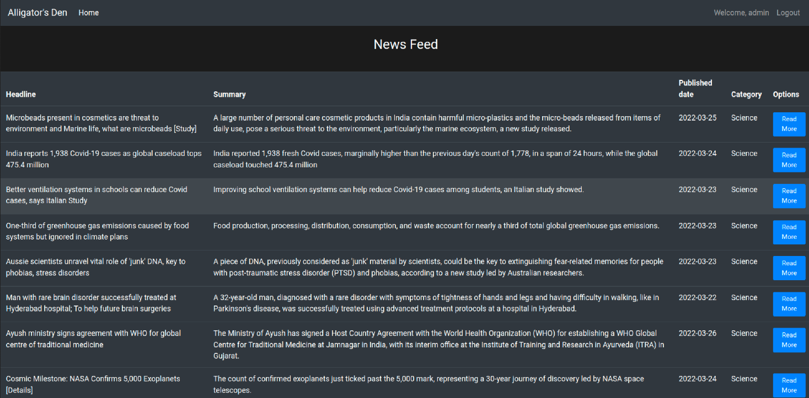](https://github.com/20akshay00/News-Recommender-System)
4.  [4. Signature Fraud Detection 2022 Applying K-means clustering to classify and detect fraudulent signatures. Python 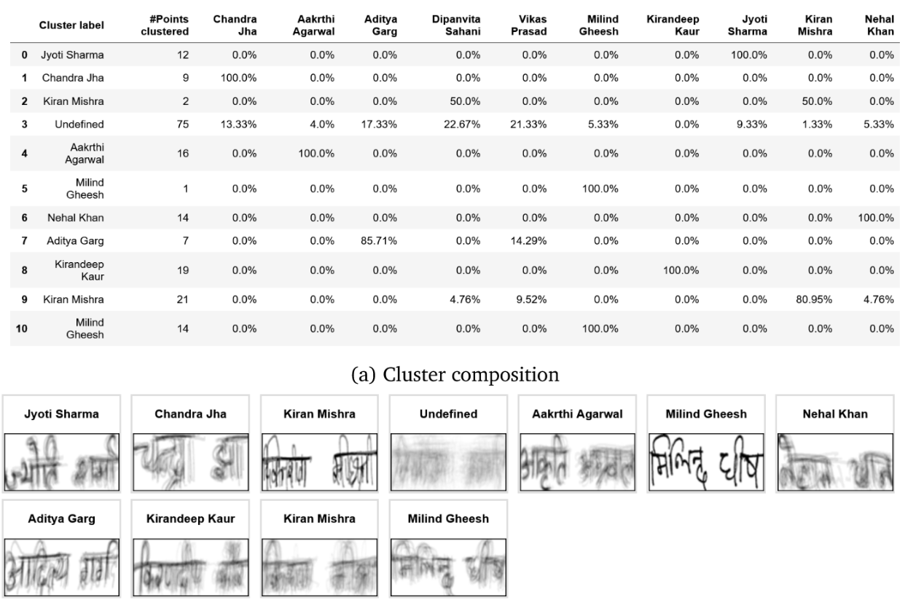](https://github.com/20akshay00/IDC409/blob/master/project_2_report.pdf)
5.  [5. Surface Waves in Fluids 2023 A theoretical exploration of the physics of waves on liquid surfaces. HTML 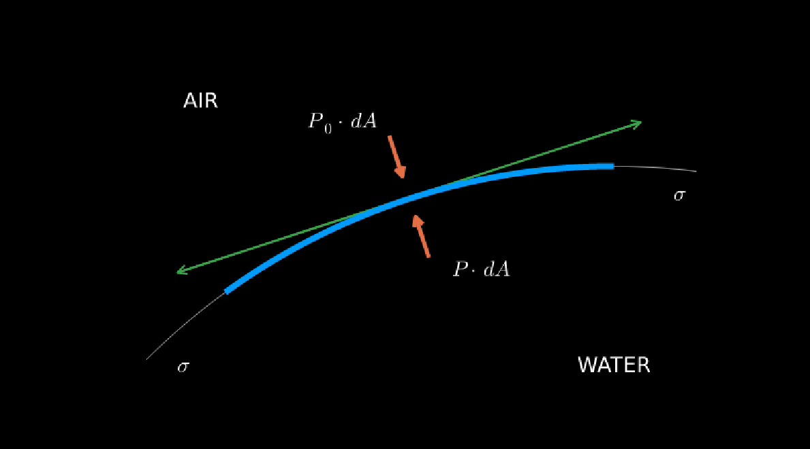](https://20akshay00.github.io/PHY638-Assignment-5/)

## Visualization

*Interactive sketches and physics visualizations from my early days of programming.*

1A▸ 2020

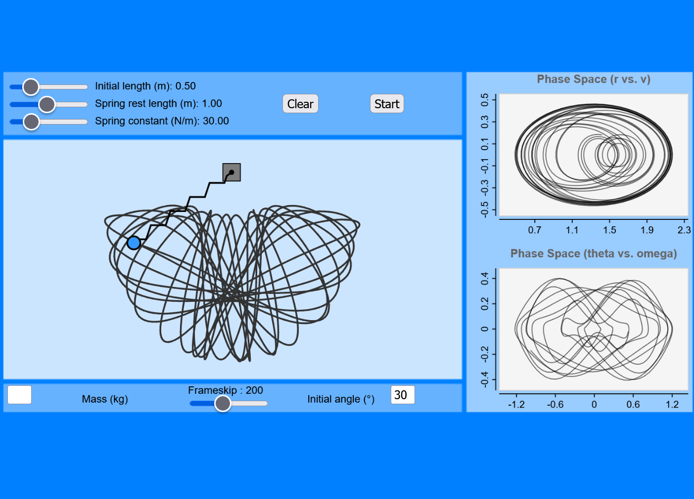

Elastic pendulum

Simulation of a pendulum with an elastic string, demonstrating chaotic motion trajectories.

JAVASCRIPT

2A▸ 2021

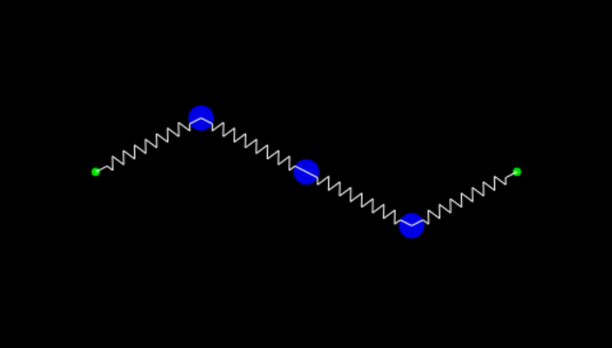

PhysicsJavisAnim

A collection of physics-based visualizations created using the Javis.jl library.

JULIA

3A▸ 2021

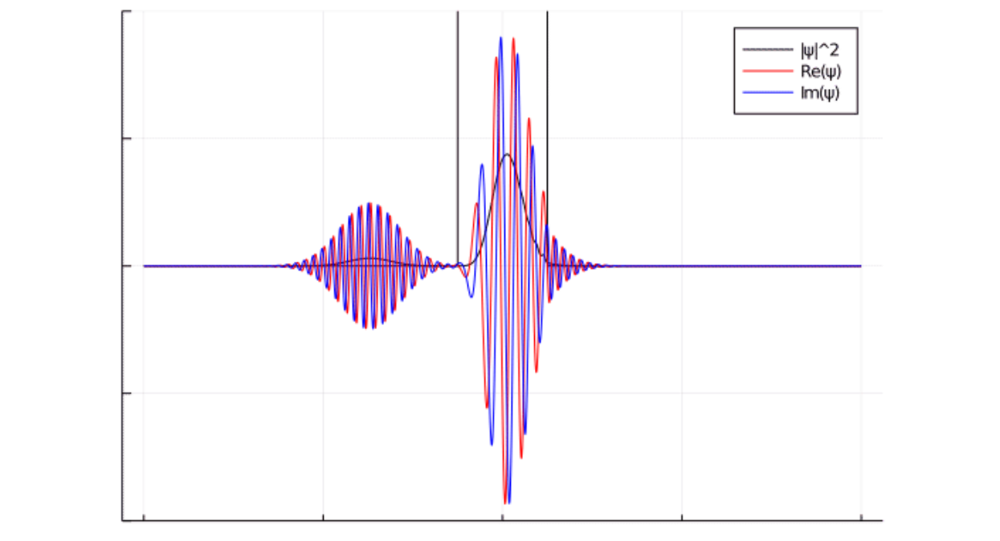

Wave-packet dynamics

Simulation of the time-evolution of a quantum mechanical wave packet in various 1D potentials.

PYTHON
