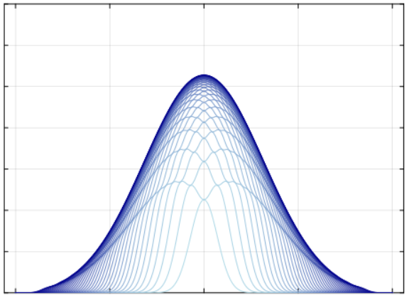
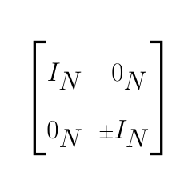
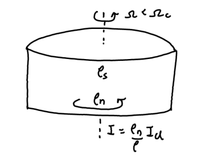
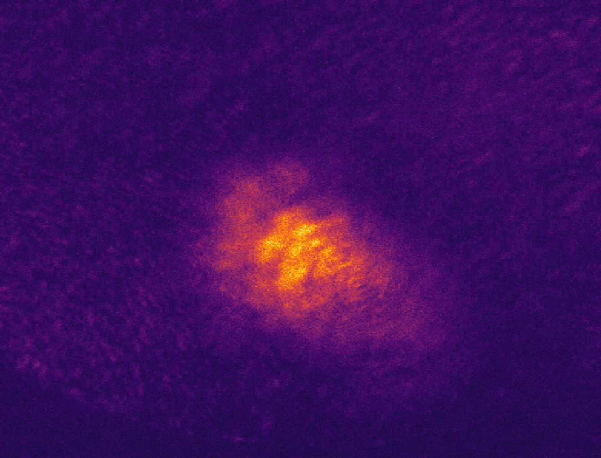
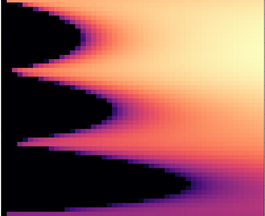

Over the course of my PhD, I’ve found that my research seems to involve solving many tiny problems which have *some* insight to offer but not enough to share in any usual platforms of scientific discourse. As an attempt to preserve these tidbits from fading into obscurity as I inevitably forget about them, I have begun documenting them here.

### [Thermal states in a quantum harmonic oscillator (I)](tidbits/harmonic-oscillator-thermal-state-1/index.llms.md)

Remember that course when you learnt a ton of identities related to the Hermite polynomials? Turns out they’re not completely useless.

Dec 5, 2025

Akshay Shankar

### [Demystifying Bogoliubov transformations](tidbits/bogoliubov-transformations/index.llms.md)

Solving quadratic Hamiltonians can be way more fun when linear algebra exposes the symmetries behind Bogoliubov transformations.

Nov 25, 2025

Akshay Shankar

### [Superfluidity as a response to phase twists](tidbits/phase-twists/index.llms.md)

Forget frictionless flow for a moment. Have you ever wondered if there is a microscopic indicator of whether a state exhibits superfluidity?

May 7, 2025

Akshay Shankar

### [The callback pattern](tidbits/callbacks/index.llms.md)

Why write a simple loop when you can over-engineer a flexible interface? Let us dive into using the Callback pattern in Julia to inject custom logic mid-simulation.

Jan 27, 2025

Akshay Shankar

### [Linearly indexing a 2D grid](tidbits/linear-indexing/index.llms.md)

Running into a number theory problem while writing scientific code isn’t as uncommon as one would imagine.

Sep 15, 2024

Akshay Shankar

### [Automating image cropping](tidbits/image-crop/index.llms.md)

A scrappy approach to automatically crop an image without human input.

Nov 21, 2023

Akshay Shankar, Dhruva Sambrani

### [Determining phase boundaries](tidbits/phase-diagram/index.llms.md)

Plotting phase boundaries shouldn’t require solving the full many-body problem. Turns out that a handful of iterations can have more information than you’d think.

Jun 1, 2023

Akshay Shankar
