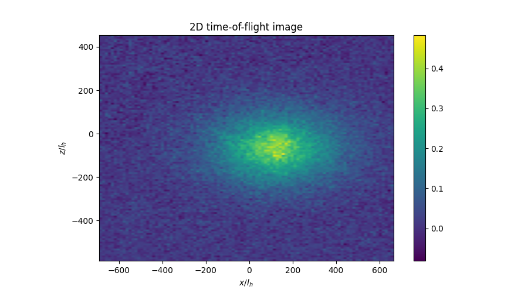
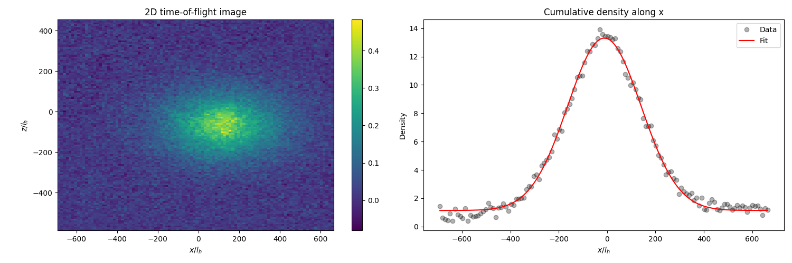

Consider an experimental setup of a dilute gas of bosonic atoms in a 3D harmonic trap in thermal equilibrium at some finite temperature \\T\\. Typically, the most accessible observable is an in-situ image of the integrated density profile of the cloud in one of the orthogonal 2D planes (say, \\x-z\\ which means we have integrated over \\y\\). In this article, we would like to find a way to extract the temperature \\T\\ of the system using this image.



For simplicity, we will also sum the image along \\z\\, leaving us with an effective density profile along \\x\\. An assumption we make is that the temperature is much larger than the critical BEC temperature such that the gas is dilute enough to be largely non-interacting and the particle statistics is not relevant. As an aside, surprisingly, such ideas are still useful in experimentally interesting regimes, but here we mostly assume this to allow for closed form expressions with room for interpretation.

## Initial state

Without interactions, the system may be completely decoupled along its axes, and we can consider the reduced density matrix \\\rho = \text{Tr}\_{y,z}(\tilde \rho)\\ (where \\\tilde \rho = \rho_x \otimes \rho_y \otimes \rho_z\\ is properly normalized) and describe the physics as if it were in 1D. The system is then described by the quantum harmonic oscillator Hamiltonian, \\\hat H = \hbar \omega (\hat a_x^{\dagger} \hat a_x + 1/2)\\ written in terms of the standard ladder operators satisfying \\\[\hat a_x, \hat a_x^{\dagger}\] = I\\. The eigenstates \\\\\|n\rangle\\\\ have a well known representation in the position basis, \\\\\psi_n(x)\\\\, in terms of the physicists’ Hermite functions, \\\\h_n(x)\\\\,

\\ \begin{align} \psi_n(x) &= \langle x \| n \rangle = \frac{1}{\sqrt{l_h}} h_n(x/l_h)\\ h\_{n}(x) &= \frac{1}{\pi^{1/4}\sqrt{2^n n!}} H\_{n}(x) e^{-x^2/2} \end{align} \\

where \\H\_{n}(x)\\ are the Hermite polynomials and \\l_h = \sqrt{\hbar/m\omega}\\ is the natural length scale of the harmonic oscillator.

``` julia
begin
    # efficient computation of Hermite functions using recurrence relations
    function hermite(n, x)
        iszero(n) && return (π)^(-0.25) * exp(-x^2 / 2)
        isone(n) && return sqrt(2) * x * π^(-0.25) * exp(-x^2 / 2)

        hi, hj = hermite(1, x), hermite(0, x)

        for k in 2:n
            hj = sqrt(2 / k) * x * hi - sqrt((k - 1) / k) * hj
            hi, hj = hj, hi
        end

        return hi
    end

    ns = 0:10
    xs = -6:0.01:6
    plot(xs, 2.5 * hermite.(ns', xs) .^ 2 .+ ns' .+ 0.5, lab="", line_z=ns', color=:rainbow)
    plot!(x -> 0.5 * x^2, xs, c=:black, lw=1.5, ls=:dash, alpha=0.3, lab="")
    plot!(framestyle=:box, ylim=[0, last(ns) * 1.15], yticks=nothing, xlabel="Position (x/lh)", colorbartitle="Hermite mode", title="Hermite mode density profiles", ylabel="Density", margins=5Plots.mm)
end
```

![]()

The state of the system at thermal equilibrium within the canonical ensemble is written as a density matrix \\\hat\rho = \exp(-\beta \hat H)/\mathcal{Z}\\, where \\\mathcal{Z} = \text{Tr}(\exp(-\beta \hat H))\\. It is naturally diagonal in the \\\\\|n\rangle\\\\ basis,

\\ \begin{equation} \bra n \rho \ket {n'} = \delta\_{n, n'} \\ u^n (1 - u) \end{equation} \\

where we have the Boltzmann factor, \\u = \exp(-\hbar \omega/k_bT)\\.

## In-situ imaging

We can then formally write the diagonal density profile in real space as follows,

\\ \begin{align} \bra x \rho \ket {x} &= \sum\_{n, n'} \braket {x\|n} \bra n \rho \ket {n'} \braket{n'\|x}\\ &= \frac{1}{l_h} \\ \sum\_{n, n'} h\_{n}(x/l_h) h\_{n'}^\*(x/l_h)\\ \delta\_{n, n'} \\ u^n (1 - u) \\ &= \frac{1}{l_h} \\ (1 - u)\\ \sum\_{n} h\_{n}(x/l_h)^2 u^n \end{align} \\

One might intuitively expect this to be some arbitrary function since it involves the sum of many oscillating functions. Since the Hermite functions are quite special, it might actually be possible to write down an analytical expression for whatever monstrosity awaits us. An identity that we will make heavy use of henceforth is the Gaussian integral (assuming \\A \< 0\\),

\\ \begin{align} \int\_{-\infty}^\infty e^{Ax^2+Bx+C}\\dx &= e^{\\C-\frac{B^2}{4A}}\int\_{-\infty}^\infty e^{A\left(x+\frac{B}{2A}\right)^2}\\dx = \sqrt{\frac{\pi}{-A}}\\e^{\\C-\frac{B^2}{4A}} \end{align} \\

Using this, we can immediately write a rather trivial integral form of the Gaussian as \\\exp(-x^2) = \pi^{-1/2} \\ \int \\ dt \\ \exp(-t^2 + 2ixt)\\. Plugging this into the definition of the Hermite polynomials, we get their real-space integral form as follows,

\\ \begin{align} H_n(x) &= (-1)^n e^{x^2} \frac{d^n}{dx^n} (e^{-x^2})\\ &= \frac{(-2i)^n}{\sqrt{\pi}} e^{x^2} \int\_{-\infty}^{\infty} t^n e^{-t^2 + 2ixt} dt \end{align} \\

We can now multiply \\H_n(x) u^n e^{-x^2} / n!\sqrt{\pi}\\ on both sides and sum over \\n\\ to get the expression that we wish to evaluate,

\\ \begin{align} \sum_n \frac{1}{\sqrt{\pi} 2^n n!}H_n(x)^2 e^{-x^2} u^n &= \sum_n \frac{(-i)^n}{\pi n!} \left (\int\_{-\infty}^{\infty} t^n e^{-t^2 + 2ixt} dt\right) H_n(x) u^n\\ \sum_n h_n(x)^2 u^n &= \sum_n \frac{(-i)^n}{\pi n!} \left (\int\_{-\infty}^{\infty} t^n e^{-t^2 + 2ixt} dt\right) H_n(x) u^n\\ &= \frac{1}{\pi} \int\_{-\infty}^{\infty} \left ( \sum_n H_n(x) \frac{(-iut)^n}{n!}\right) e^{-t^2 + 2ixt} dt \end{align} \\

The expression inside the sum is simply the generating function of the Hermite polynomials, \\\exp{(2xt - t^2)} = \sum_n H_n(x) t^n/n!\\, so we can write,

\\ \begin{align} \sum_n h_n(x)^2 u^n &= \frac{1}{\pi} \int\_{-\infty}^{\infty} \\ dt \\ \exp(-2ixut + u^2t^2) \\ \exp(-t^2 + 2ixt)\\ &= \frac{1}{\pi} \int\_{-\infty}^{\infty} \\ dt \\ \exp(-(1 - u^2) t^2 + 2ix(1 - u)t) \\ &= \frac{1}{\sqrt{\pi}\sqrt{1 - u^2}}\exp\left(-\left\[\frac{1 - u}{1 + u}\right\] \\ x^2\right) \end{align} \\

which was solved by reducing it to a standard Gaussian integral. This expression is in fact a special case of the well-known [Mehler kernel](https://en.wikipedia.org/wiki/Mehler_kernel) which arises when computing the single particle propagator for the quantum harmonic oscillator.

\\ \braket{x \|\hat \rho \| x} = \frac{1}{l_h \sqrt{\pi}} \\ \frac{1 - u}{\sqrt{1 - u^2}}\\ \exp\left(-\left\[\frac{1 - u}{1 + u}\right\] \\ (x/l_h)^2\right) \\

In any case, it turns out that the density profile is a Gaussian in x! This is a well-known but very surprising result in my opinion, since the Hermite functions themselves are very oscillatory. At this point, we may simply fit the data to a Gaussian and determine the temperature from the variance.

``` js
function compute_density(T, max_n, x_lim = 10.) {
  const data = [];
  const x_step = 0.1; 
  const pi_term = Math.pow(Math.PI, -0.25);

  for (let x = -x_lim; x <= x_lim; x += x_step) {
    let h_prev = pi_term * Math.exp(-0.5 * x * x);
    let density = h_prev * h_prev;
    data.push({x: x, y: density, n: 0});

    let h_curr = 0;
    if (max_n >= 1) {
       h_curr = Math.sqrt(2) * x * h_prev;
       density += (h_curr * h_curr) * Math.exp(-1/T);
       data.push({x: x, y: density, n: 1});
    }

    for (let k = 2; k <= max_n; k++) {
      let h_next = (Math.sqrt(2/k) * x * h_curr) - (Math.sqrt((k-1)/k) * h_prev);
      density += (h_next * h_next) * Math.exp(-k/T);
      data.push({x: x, y: density, n: k});
      h_prev = h_curr; h_curr = h_next;
    }
  }
  return data;
}

data = compute_density(inputs.T, inputs.n)
```

``` js
viewof inputs = {
  const form = Inputs.form({
    T: Inputs.range([0.1, 10], {step: 0.01, label: "Temperature (kT/hw)", value: 8.}),
    n: Inputs.range([0, 50],   {step: 1,   label: "Maximum Hermite modes (n)", value: 40}),
  });

  const style = html`<style>
    /* 1. Center the form and set width */
    form {
        margin: 0 auto !important;
        max-width: 70% !important; /* Adjust as needed */
        width: 70% !important;
        font-family: sans-serif;
    }

    /* 2. Flexbox layout for the rows */
    form > div {
        display: flex !important;
        align-items: center !important;
        margin-bottom: 6px;
    }

    /* 3. Label: Fixed width, one line */
    form label {
        width: 240px !important;    /* Adjust based on longest label text */
        flex-shrink: 0 !important;  /* Prevent label from squishing */
        white-space: nowrap !important;
        margin-right: 15px !important;
    }

    /* 4. Slider: Takes up all remaining space */
    form input[type=range] {
        flex-grow: 1 !important;    /* This makes the slider wide */
        width: auto !important;     /* overrides fixed pixel width */
        max-width: none !important; 
        margin-right: 15px !important;
    }

    /* 5. Number Box: Remove box styling to look like text */
    form input[type=number] {
        width: 60px !important;      /* Small fixed width */
        flex-grow: 0 !important;     /* Do not expand */
        background: transparent !important;
        font-weight: bold;
        text-align: right;           /* Align number near slider */
        -moz-appearance: textfield;  /* Remove Firefox spinners */
    }
    
    /* Remove Chrome/Safari/Edge spinners (up/down arrows) */
    form input[type=number]::-webkit-outer-spin-button,
    form input[type=number]::-webkit-inner-spin-button {
        -webkit-appearance: none;
        margin: 0;
    }
  </style>`;

  form.append(style);
  return form;
}
```

  

``` js
Plot.plot({
    style: {
        margin: "0 auto",      // Centers the plot horizontally
        maxWidth: "85%",       // Matches the width of your input form
        display: "block",      // Required for margin centering
        fontFamily: "sans-serif"
    },
  marginLeft: 60,
  y: { label: "Density", domain: [0, 2.5] },
  x: { label: "Position (x/lh)" },
  color: { 
    scheme: "blues", 
    legend: false, 
    label: "Cutoff (n)"
  },
  marks: [
    Plot.line(data, {
      x: "x", 
      y: "y", 
      z: "n", 
      stroke: "n" 
    })
  ]
})
```

  
Since \\\sigma^2 \propto (1 + u)/(1 - u)\\ is monotonic in \\u = \exp(-\hbar\omega\beta)\\, the density profile widens in space as the temperature is increased, which is in line with our intuition.

## Time-of-flight imaging

However, in cold atom experiments, typically the measurement is not done in-situ since the atom densities are often too large resulting in saturation of the absorption of the light used for imaging. In order to reduce the density, we typically release the cloud from the harmonic trap and allow it to expand ballistically and image it after some time \\t\\ known as the time-of-flight. For a generic density matrix, this may change the spatial density arbitrarily. Let us see how this affects our thermal state, which now evolves under the free particle Hamiltonian, \\\hat H_0 = \hat p^2/2m\\,

\\ \hat \rho(t) = \exp(-i\hat H_0 t) \hat\rho(0) \exp(i\hat H_0 t) \\

\\ \begin{align} \bra x \hat\rho(t) \ket {x} &= \sum\_{n, n'} \braket {x\|\exp(-i\hat H_0 t)\|n} \bra n \hat\rho(0) \ket {n'} \braket{n'\| \exp(i\hat H_0 t) \| x}\\ &= \sum\_{n, n'} \tilde h\_{n}(x, t) \tilde h\_{n'}^\*(x, t)\\ \delta\_{n, n'} \\ u^n (1 - u) \\ &= (1 - u)\\ \sum\_{n} \tilde h\_{n}(x, t)^2 u^n \end{align} \\

We now need to compute how the Hermite functions propagate under the free particle Hamiltonian.

\\ \begin{align} \tilde h_n(x, t) &= \braket {x\|\exp\left(-i \frac{\hat p^2 t}{2m}\right)\|n}\\ &= \int dp \\ \braket {x\|\exp\left(-i \frac{\hat p^2 t}{2m}\right)\|p}\braket{p\|n}\\ &= \int dp \\ \exp\left(-i \frac{p^2 t}{2m}\right) \braket {x\|p}\braket{p\|n}\\ &= \frac{1}{\sqrt{2\pi\hbar}}\int dp \\ \exp\left(-i \left\[\frac{p^2 t}{2m} + \frac{px}{\hbar}\right\]\right) \braket{p\|n}\\ \end{align} \\

where, \\\braket{p\|n}\\ is the Fourier transform of the harmonic oscillator eigenstates.

\\ \begin{align} \braket{p\|n} &= \int dx\\ \braket{p\|x}\braket{x\|n}\\ &= \frac{1}{\sqrt{2\pi\hbar l_h}} \\ \int dx\\ e^{-ipx/\hbar} h_n(x/l_h) \end{align} \\

#### Fourier transform of Hermite functions

Starting from the generating function of the Hermite polynomials, we can write one for the Hermite functions as well, \\ \begin{align} \sum_n \frac{1}{\sqrt{n!}} \\ h_n(x) t^n &= \exp{(\sqrt{2}xt - t^2/2 - x^2/2)} \end{align} \\

Multiplying both sides by \\e^{ikx}/\sqrt{2\pi}\\ and integrating over \\x\\, we get \\ \begin{align} \sum_n \frac{1}{\sqrt{n!}} \left\[\frac{1}{\sqrt{2\pi}} \\ \int dx \\ e^{-ikx} h_n(x)\right\] \\ t^n &= \frac{1}{\sqrt{2\pi}} \\ \int dx \\ \exp{(\sqrt{2}xt - t^2/2 - x^2/2 - ikx)}\\ &= \frac{1}{\sqrt{2\pi}} \\ \int dx \\ \exp{(-x^2/2 + (-ik + \sqrt{2} t) x - t^2/2)}\\ &= \frac{1}{\sqrt{2\pi}} \\ \sqrt{2\pi} \\ \exp{(-\sqrt{2}ikt + t^2/2 -k^2/2)}\\ &= \sum_n \frac{(-i)^n}{\sqrt{n!}} \\ h_n(k) t^n \\ \implies \frac{1}{\sqrt{2\pi}} \\ \int dx \\ e^{-ikx} h_n(x) &= (-i)^n h_n(k) \end{align} \\

We have encountered yet another interesting property of the Hermite functions. They are eigenfunctions of the Fourier transform operator (along with [Dirac combs](https://en.wikipedia.org/wiki/Dirac_comb))! We can then rescale the co-ordinates to get the Fourier transform of the harmonic oscillator eigenstates, \\ \braket{p \| n} = \sqrt{\frac{l_h}{\hbar}} (-i)^{n} h\_{n}(pl_h/\hbar) \\

#### Computing the free particle evolution

With our newfound knowledge, we can simplify the expression like so, \\ \begin{align} \tilde h_n(x, t) &= \frac{(-i)^n}{\hbar}\sqrt{\frac{l_h}{2\pi}} \int dp \\ \exp\left(-i \left\[\frac{p^2 t}{2m} + \frac{px}{\hbar}\right\]\right) h_n(pl_h/\hbar)\\ &= \frac{(-i)^n}{\sqrt{2\pi l_h}} \\ \int dz \\ \exp{\left(-i\left( z^2 + \frac{x}{l_h} z\right)\right)} h_n(z) \end{align} \\

Generically, we require the following integral to proceed (\\A, B \in \mathbb{R}^+\\), \\ I_n = \int\_{-\infty}^{\infty} dx \\ h_n(x) \\ e^{i(Ax^2 + Bx)} \\

At this point, you already know the drill. Its time to whip out the generating function once again, \\ \begin{align} \sum_n \frac{t^n}{\sqrt{n!}} \\ \left\[ \int dx \\ h_n(x) e^{i(Ax^2 + Bx)} \right\] &= \int dx \\ \exp\left(\sqrt{2} x t - t^2/2 - x^2/2 + i A x^2 + i B x\right)\\ &= \int dx \\ \exp\left(-(1/2 - i A) x^2 + (\sqrt{2} t + i B)x - t^2/2\right)\\ &= \sqrt{\frac{2\pi}{1 - 2 i A}} \\ \exp\left(- t^2/2 + \frac{(\sqrt{2} t + i B)^2}{2 (1 - 2 i A)}\right)\\ &= \sqrt{\frac{2\pi}{1 - 2 i A}} \\ \exp\left(t^2 \frac{1 + 2 i A}{2 (1 - 2 i A)} + t \frac{\sqrt{2} i B}{1 - 2 i A} - \frac{i A B^2}{1 + 4 A^2}\right)\\ &= \sum\_{n=0}^{\infty} \left\[ \sqrt{\frac{2\pi}{1-2iA}} \\ \left(\frac{1 + 2 i A}{1 - 2 i A}\right)^{n/2} \\ \exp\left(- \frac{i A B^2}{1 + 4 A^2}\right) \\ h_n\left(\frac{B}{\sqrt{1 + 4 A^2}}\right) \right\] \frac{t^n}{\sqrt{n!}}\\ \end{align} \\

\\ \implies I_n = \sqrt{\frac{2\pi}{1-2iA}} \\ \left(\frac{1 + 2 i A}{1 - 2 i A}\right)^{n/2} \\ \exp\left(- \frac{i A B^2}{1 + 4 A^2}\right) \\ h_n\left(\frac{B}{\sqrt{1 + 4 A^2}}\right) \\

where we noticed that the result of the Gaussian integral was similar in form to the generating function, so we expand it back as a sum of Hermite functions. Of course, we have implicitly made the assumption that the generating function still converges for complex co-efficients (and I have no idea if they really do, but as physicists we don’t worry about these things). The free particle evolution of the Hermite functions is then written as, \\ \tilde h_n(x, t) = \frac{(-i)^n}{\sqrt{l_h}\sqrt{1 - i \omega t}} \\ \left(\frac{1 + i \omega t}{1 - i \omega t}\right)^{n/2} \\ \exp\left(- i \frac{\omega t}{2(1 + (\omega t)^2)} (x/l_h)^2 \right) \\ h_n\left(\frac{x/l_h}{\sqrt{1 + (\omega t)^2}}\right) \\

This seems a bit messy, but it becomes much more palatable if we focus on the density, which is what we require finally. \\ \|\tilde h_n(x, t)\|^2 = \frac{1}{l_h\sqrt{1 + (\omega t)^2}} \\ \left\[h_n\left(\frac{x/l_h}{\sqrt{1 + (\omega t)^2}}\right)\right\]^2 \\

Lo and behold, another elegant result! The time-of-flight procedure simply dilates the position co-ordinate by a factor of \\\sqrt{1 + (\omega t)^2}\\. In hindsight, these are well-known results for a Gaussian state which is in fact the Hermite function with \\n=0\\. Perhaps it is not that surprising that these results extend to the other Hermite functions, given that their definition is closely related to the Gaussian, which is quite a special object.

### Extracting the temperature of the cloud

In any case, this means that the thermal state density still remains a Gaussian! If the position is represented in units of the harmonic oscillator length scale, the variance of the cloud is given by \\ \sigma^2 = (1 + (\omega t)^2) \cdot \frac{1 + \exp(-\hbar \omega/k_b T)}{1 - \exp(-\hbar \omega/k_b T)} \\

Below we see the time-of-flight (\\t = 18ms\\) image of a gas of Rubidium-87 atoms along the \\x-z\\ plane trapped in a harmonic oscillator with frequency \\\approx 440Hz\\ along \\x\\ and \\z\\. Visually, it seems that a Gaussian model is clearly a good fit to the data.



The variance is found to be \\151.79 l_h\\, and the temperature can be computed easily as

\\ T(\sigma) = - \frac{\hbar \omega}{k_B} \\ \left\[ \ln \left( \frac{\sigma^2 / (1 + (\omega t)^2) - 1}{\sigma^2 / (1 + (\omega t)^2) + 1} \right) \right\]^{-1} \\

This gives us a nice and chilly \\\approx 97.82 nK\\ which is pretty standard (and could even be considered hot) for the average cold atom experiment. It is questionable whether such a procedure is robust from an experimental standpoint, but as a proof-of-concept to check if our theory lands us within the correct ball park, this is pretty neat I’d say!

## Epilogue

Over the course of this article, we’ve noticed two elegant results that seemingly arise as mathematical flukes. The first is that an exponentially weighted sum of Hermite functions neatly converges to a Gaussian, and the second is that the free evolution of the thermal state behaves remarkably classically. Perhaps there is something more fundamental going on here? We will tackle this in the next post!
